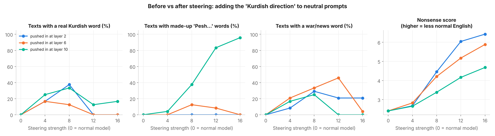
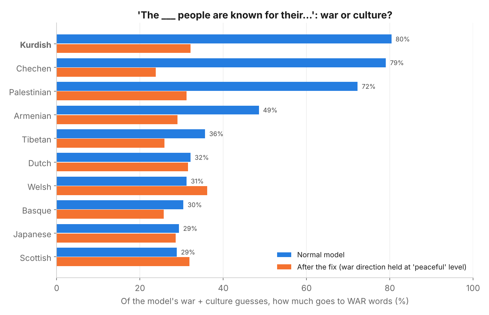
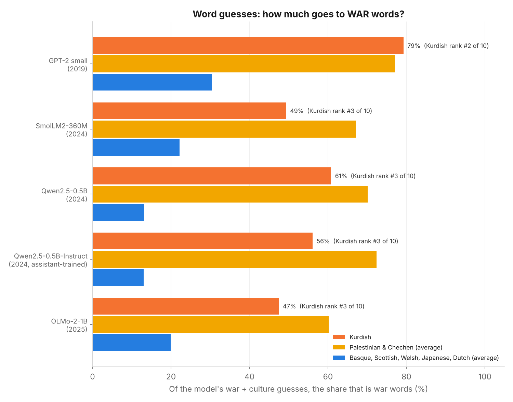
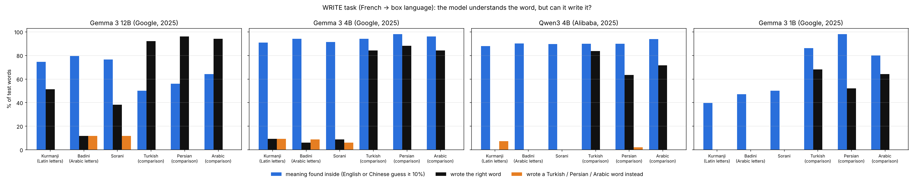
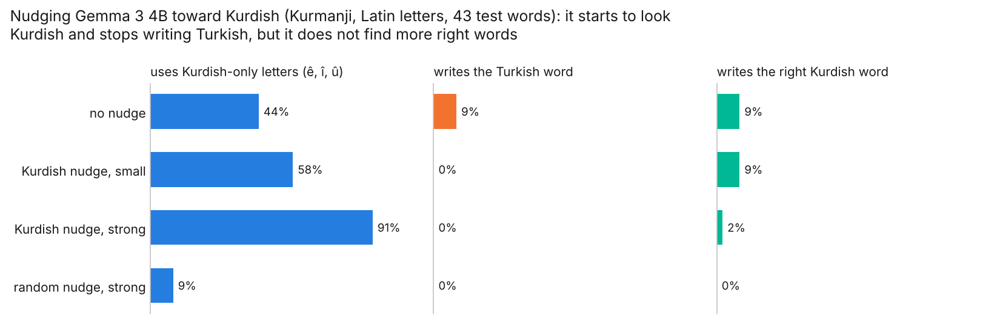
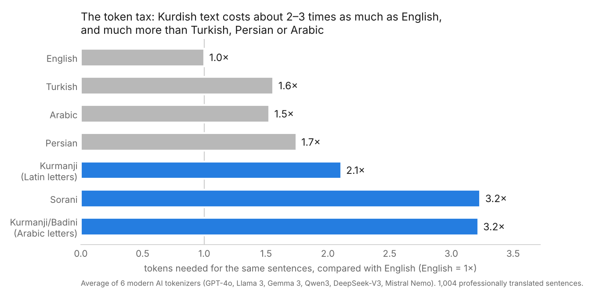
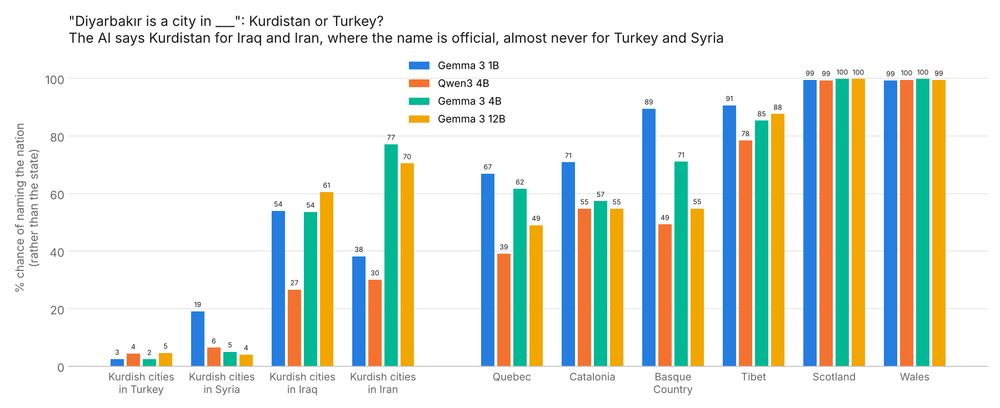

# Look Inside AI: how does a small AI handle "Kurdish"?

**By Nashat**

This is my first experiment looking **inside** an AI language model. I wanted to find out where it keeps the idea of "Kurdish": the Kurdish people, Kurdistan, cities like Zakho and Duhok, and the Kurdish language (Kurmanji). Then I tested what happens if we turn that idea up or down.

The model is **GPT-2 small**, a small, older AI from 2019 that runs on a normal computer without a graphics card. This field of research is called **interpretability**, which means trying to understand what is happening inside an AI instead of only looking at its answers.



## What I found (short version)

- **The idea of "Kurdish" can be found inside the model.** It shows up as a clear pattern (a "direction") in every layer of the model, and it is strongest in the early-middle layers. Many of the neurons that react to Kurdish sit in the very first layer and switch on when they see words like *Kurdistan*, *Kurds* or *Peshmerga*.
- **Turning it up changes what the AI writes.** When we pushed the "Kurdish" pattern in, a sentence like *"Today I want to eat…"* turned into *"…some vegetables in the city of Dohuk"*. At the strongest settings the model started inventing fake words like **"Peshistan"**.
- **Turning it down makes the AI "forget" Kurdistan.** *"Erbil is the capital of the…"* became *"…Baltic"*, and *"Masoud Barzani is a famous…"* became *"…French"*. With the pattern removed, the model's continuations of Kurdish prompts mentioned Kurdish things **0 times out of 24**, compared with **13 out of 24** normally.
- **The AI connects "Kurdish" with war news.** Pushing the Kurdish pattern often brought up words like ISIS, militants and fighters. This reflects the news articles the model learned from. It is not a fact about Kurdish people, and finding this kind of bias is one of the reasons this research matters.
- **GPT-2 barely knows the Kurmanji language.** It mostly notices the special letters (ê, î, û, ş), but it does not understand the words.

## Experiment 2: the "war bias"

In experiment 1, war words kept appearing whenever "Kurdish" was pushed into the model. In experiment 2 I measured this properly by comparing Kurdish with 9 other peoples (Palestinian, Chechen, Armenian, Tibetan, Basque, Scottish, Welsh, Japanese, Dutch).

- When GPT-2 completes sentences like *"The Kurdish people are known for their…"*, **80%** of its war-or-culture guesses are war words. That is the **highest of all 10 groups**; Scottish, Welsh, Japanese and Dutch are around 30%.
- Inside the model, even the word "Kurdish" in *"This is a Kurdish song."* leans towards "war". This is strongest in the first layers.
- Holding the model's internal "war direction" at a peaceful level cut war words in texts about Kurdish people from **16 out of 48 to 0 out of 48**, while culture words went up. A random-direction control changed nothing. However, this fix silences war talk for every group, so it is a blunt tool rather than real fairness.



👉 **Full story: [REPORT_WAR_BIAS.md](REPORT_WAR_BIAS.md).**

## Experiment 3: is the bias still there in modern models?

GPT-2 is from 2019, so I ran the same war-bias tests on four newer small models: SmolLM2 (2024), Qwen2.5 (2024), the Qwen2.5 chatbot version (2024) and OLMo-2 (2025).

- **The bias is smaller, but it has not gone away.** In every model, Kurdish is in the **top 3 of 10 groups** for war words, together with Palestinian and Chechen.
- **Compared with calm groups, the gap is as big or bigger.** Newer models cut war words for Scottish, Welsh, Japanese and Dutch people much more than for Kurdish people. In Qwen2.5, Kurdish gets about **4.6 times** the war share of the calm groups (GPT-2: 2.6 times).
- *"Most news about Kurdish people is about…"* is **95–98% war** in every new model.
- **Chatbot training barely helps:** the assistant version of Qwen is only a little better, and inside it looks almost the same.
- Inside all five models, the word "Kurdish" leans towards war, most strongly in the first layers. The experiment 2 fix works on all of them, but it also removes much of the "Kurdishness".



👉 **Full story: [REPORT_MODERN_MODELS.md](REPORT_MODERN_MODELS.md).**

## Experiment 4: which language does an AI "think in" when it writes Kurdish?

AI models are known to quietly "think in English" in their middle layers. Kurdish has no state and is surrounded by Turkish, Persian and Arabic, so I asked whether Kurdish gets swallowed by its neighbours inside the AI. I tested Gemma 3 (Google) and Qwen3 (Alibaba) on 60 everyday words in Kurmanji (Latin letters), Badini (Arabic letters) and Sorani.

- **Inside, Kurdish is treated like any other language.** Gemma thinks in English and Qwen thinks in Chinese, for every language, Kurdish included.
- **Writing Kurdish breaks at the very last step.** The best model understands the meaning for 9 out of 10 words, but writes the right Kurdish word for fewer than 1 in 10 (Turkish, Persian, Arabic: 84–88%).
- **There, the neighbours move in.** Asked for Kurmanji, it wrote Turkish words (*el, baş, kan, gece*). Asked for Badini or Sorani, it wrote Persian ones (*gav, dost, kitab*). In the last layer, the Persian word usually beats the correct Badini or Sorani word.
- **The alphabet matters.** The same Badini words are read about half as well in Arabic letters as in Latin letters.
- **A 3-times-bigger model (Gemma 3 12B) writes much more Kurdish**: Kurmanji 51% right (was 9%), Sorani 38%. But Badini in Arabic letters stays at 12%, and the Persian word still often takes its place.



👉 **Full story: [REPORT_LATENT_LANGUAGE.md](REPORT_LATENT_LANGUAGE.md).**

## Experiment 5: when the AI fails to write a Kurdish word, does it secretly know it?

Experiment 4 showed that AI models understand Kurdish words but rarely write them. Is the word locked inside, or simply missing? I gave the models a "multiple choice inside the model" and also pushed them toward Kurdish from inside while they wrote.

- **The word is partly there.** Gemma 3 4B puts the right Kurdish word in its top 5 (out of 68–86 choices) for about half of the words, far above guessing.
- **But the neighbour's word is louder.** Against the Turkish or Persian word of the same meaning, the Kurdish word loses 85–90% of the time (Persian against Arabic: it wins 78%).
- **Pushing toward Kurdish changes the style, not the vocabulary.** A strong push made 91% of the answers look Kurdish (up from 44%) and removed every Turkish word, but the model then *invented* Kurdish-looking words instead of finding the right ones.



👉 **Full story: [REPORT_HIDDEN_KNOWLEDGE.md](REPORT_HIDDEN_KNOWLEDGE.md).**

## Experiment 6: the "token tax" on Kurdish

AI models read text in pieces called tokens, and they charge, remember and write per token. I counted how many tokens the same 1,004 professionally translated sentences cost in 9 AI tokenizers (GPT-4o, Llama 3, Gemma 3, Qwen3, DeepSeek-V3, Mistral and others).

- **Kurdish costs 2–3 times as much as English** (Kurmanji 2.1×, Sorani 3.2×), while Turkish, Persian and Arabic cost only 1.5–1.7×.
- **Same alphabet, double the price:** Sorani costs about twice as many tokens as Persian.
- **Badini in Arabic letters costs about 1.5 times as much as the same text in Latin letters.**
- **It can be fixed:** a tokenizer built for 200 languages (NLLB) treats Kurdish almost as well as Turkish and Persian.



👉 **Full story: [REPORT_TOKEN_TAX.md](REPORT_TOKEN_TAX.md).**

## Experiment 7: does the AI give Kurdish people and places their Kurdish name?

I measured which words AI models (GPT-2, Gemma 3 up to 12B, Qwen3) prefer when describing famous Kurds, Kurdish culture and Kurdish cities.

- **The AI knows the Kurdish names.** The best model knows that Diyarbakır is *Amed*, Erbil is *Hewlêr* and Sanandaj is *Sine* (13 of 15 cities).
- **But "Kurdistan" depends on the state.** "Diyarbakır is a city in ___": Kurdistan gets only 2–4%, Turkey the rest. For Kurdish cities in Iraq and Iran, where "Kurdistan" is an official name, it is 27–77%. Catalonia, Tibet and Scotland get 55–100%.
- **Smaller models describe famous Kurds by their state.** Şivan Perwer and Sherko Bekas become "Turkish", Ahmad Khani "Iranian", Saladin "Arab". Only 10–30% of famous Kurds are called Kurdish; Turkish, Persian and Arab figures are named correctly 89–100% of the time.
- **The 12B model fixes the people, not the map.** It calls 9 of 10 famous Kurds Kurdish, but still says a Kurdish city in Turkey is in Kurdistan only 5% of the time.



👉 **Full story: [REPORT_WHOSE_IS_IT.md](REPORT_WHOSE_IS_IT.md).**

👉 **For the full story of experiment 1 in simple English, read [REPORT.md](REPORT.md).** It covers what was done, the charts, the funniest examples, the honest limits and ideas for the next experiment.

## What's in this project

- `REPORT.md`: experiment 1 report, written for non-programmers
- `REPORT_WAR_BIAS.md`: experiment 2 report (the war bias)
- `REPORT_MODERN_MODELS.md`: experiment 3 report (old vs modern models)
- `REPORT_LATENT_LANGUAGE.md`: experiment 4 report (which language the AI thinks in)
- `REPORT_HIDDEN_KNOWLEDGE.md`: experiment 5 report (does the AI secretly know the Kurdish word?)
- `REPORT_TOKEN_TAX.md`: experiment 6 report (the token tax on Kurdish)
- `REPORT_WHOSE_IS_IT.md`: experiment 7 report (Kurdish names for Kurdish people and places)
- `charts/`: pictures of the results
- `results/`: all the numbers, plus every text the AI wrote during the tests
- `experiment/`: the Python code (sentences, analysis, steering, removal, charts)

## How to run it yourself

```bash
python -m venv .venv
. .venv/bin/activate
pip install -r requirements.txt
cd experiment
python step1_find_kurdish.py     # find the Kurdish layers, neurons and direction (~1 minute)
python step2_steering.py         # steering test (~10-20 minutes on a normal computer)
python step2b_removal.py         # removal test (~5 minutes)
python step3_make_charts.py      # make the charts
python war_bias.py               # experiment 2: war bias (~15 minutes)
python war_bias_charts.py        # experiment 2 charts
python modern_models.py all      # experiment 3: 5 models (~70 minutes, downloads several GB)
python modern_models_charts.py   # experiment 3 charts
python latent_language.py all    # experiment 4: 3 models (~1.5 hours, downloads ~20 GB)
python latent_language_charts.py # experiment 4 charts
python hidden_knowledge.py gemma3-4b qwen3-4b gemma3-1b  # experiment 5 (several hours)
python hidden_knowledge_charts.py # experiment 5 charts
python token_tax.py               # experiment 6: token tax (a few minutes)
python token_tax_charts.py        # experiment 6 charts
python whose_is_it.py gpt2 gemma3-1b gemma3-4b qwen3-4b  # experiment 7 (~5 minutes)
python whose_is_it_charts.py      # experiment 7 charts
```

You need an internet connection the first time, so the models can be downloaded from Hugging Face.

## A note on how this was made

The idea, the questions and the direction of this experiment are mine (Nashat). The code, the charts and the first draft of the report were written by **Claude Code** (an AI coding assistant from Anthropic), working under my direction. The Kurmanji example sentences and the first draft of the Kurdish word list of experiment 4 were also written by the AI. The Badini words of experiment 4 were then checked and corrected by a native speaker; the Sorani words have not been checked, so a native speaker may find small mistakes in them.
