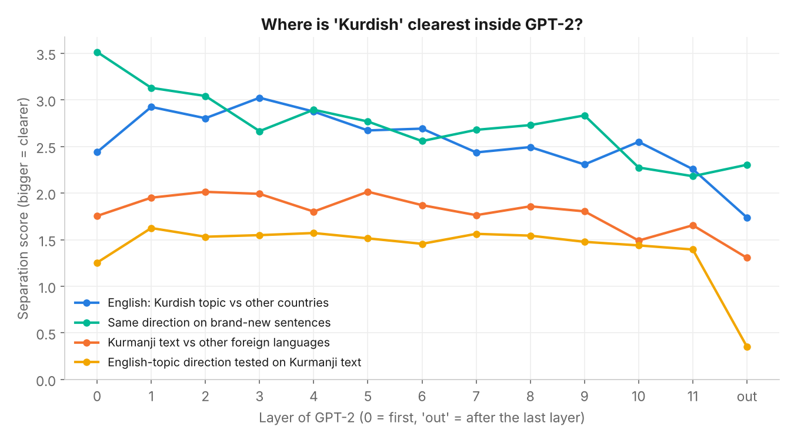
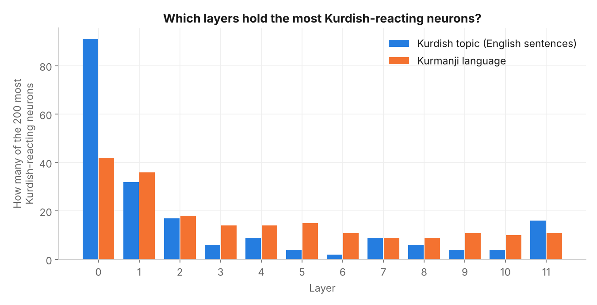
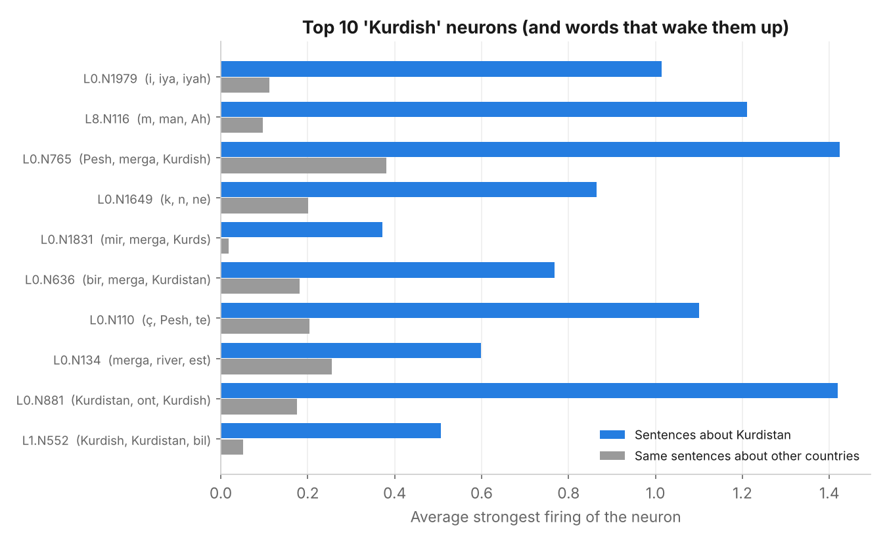
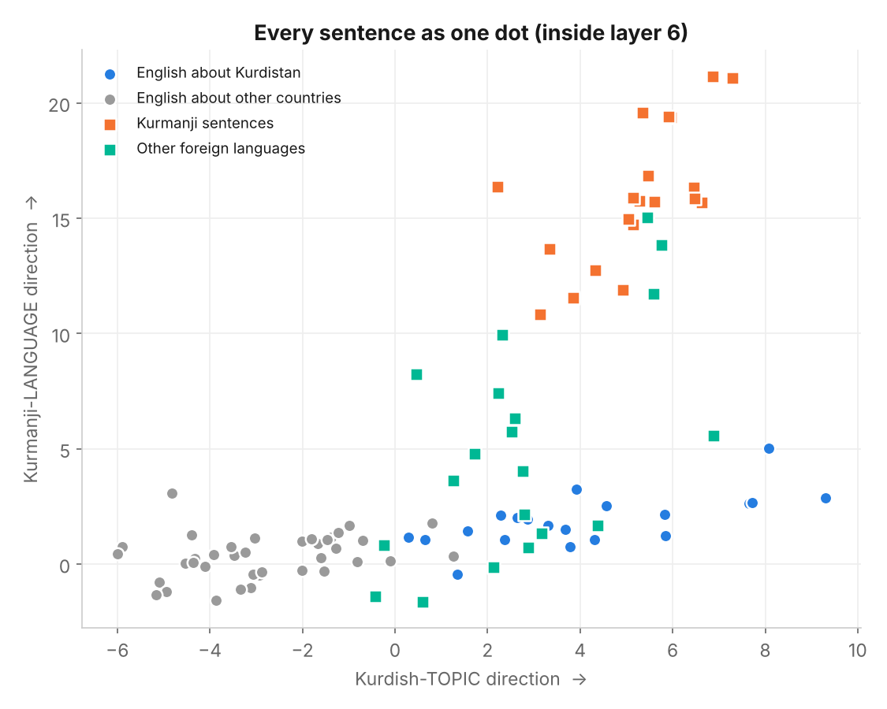
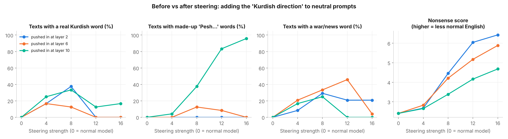
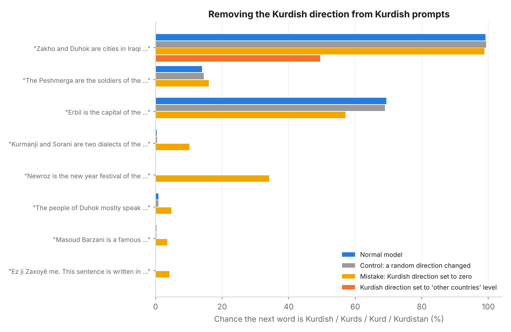

# Looking inside an AI: where does GPT-2 keep the idea of "Kurdish"?

*A first interpretability experiment, written for people who are not programmers.*

---

## 1. The short version

- We opened up a small AI language model called **GPT-2** and looked at the numbers it calculates while it reads a sentence.
- We **can** find a clear "Kurdish signal" inside it. It is already visible in the **first layers**, and it stays visible all the way through.
- When we **push this signal in by force**, the model starts talking about Kirkuk, Duhok, Mosul and the Peshmerga, even when it was asked about food or the weather. When we push very hard, it starts inventing fake words like **"Peshistan"**.
- When we **take the signal away**, the model "forgets" Kurdistan. *"Erbil is the capital of the…"* becomes *"…Baltic"*, and *"Masoud Barzani is a famous…"* becomes *"…French"* or *"…chef"*.
- A sad but important finding: for this model, "Kurdish" is tied very closely to **war and news words** (ISIS, militants, fighters). That comes from the news articles it learned from, not from reality.

---

## 2. A few words explained (one sentence each)

| Word | Meaning |
|---|---|
| **Language model** | A computer program that has read a lot of text and learned to guess the next word. |
| **GPT-2 small** | A small, older (2019) language model from OpenAI with 124 million numbers inside. It is small enough to run on a normal computer without a graphics card. |
| **Token** | A piece of a word that the model reads one at a time. For example, "Zakho" is read as "Zak" + "ho". |
| **Layer** | GPT-2 thinks in 12 steps, one after another. Each step is a layer. Layer 0 comes first and layer 11 comes last. |
| **Activation** | The list of numbers the model has in its "head" at one layer while it reads a word. |
| **Neuron** | One single number-maker inside a layer. GPT-2 small has 3,072 of them in each layer, 36,864 in total. |
| **Residual stream** | The model's running "notebook": 768 numbers per word that every layer reads from and writes into. |
| **Direction** | A recipe of "a bit more of these numbers, a bit less of those". It points from "normal" towards some idea. |
| **Kurdish direction** | The average notebook for Kurdish sentences minus the average notebook for other sentences. |
| **Steering** | Adding a direction into the notebook while the model writes, to push its thoughts one way. |
| **Removal (ablation)** | Taking a direction out of the notebook, to see what the model can no longer do. |
| **Control** | A fake version of a test, run in the same way, to check that the effect isn't just luck. |
| **Held-out sentences** | Sentences we hide while building the direction, then use only for testing it, so the model can't just "remember the answers". |
| **Probability** | How likely the model thinks a word is to come next, from 0% to 100%. |

---

## 3. What we did, step by step

1. **We set up the tools.** We used Python, PyTorch (the maths engine), TransformerLens (a tool for looking inside models) and matplotlib (for charts). Everything ran on an ordinary processor.
2. **We loaded GPT-2 small.**
3. **We wrote four groups of sentences** (see `experiment/sentences.py`):
   - **A.** 20 English sentences about Kurdistan, Kurdish, Zakho, Duhok, Erbil… for example *"Students in Duhok study Kurdish at school."*
   - **B.** 40 sentences that use exactly the **same sentence patterns**, but with Turkey, Germany, Japan, France, Iran… for example *"Students in Munich study German at school."* Because the patterns are identical, the only real difference between A and B is "Kurdish or not".
   - **C.** 20 short sentences in **Kurmanji** (Latin script), for example *"Îro hewa gelek xweş e."* Most of them contain no place names, so the model has to notice the language itself.
   - **D.** 20 short sentences in **other languages** (Turkish, German, Spanish, French, Indonesian, Dutch, Polish). We added this extra group so we could tell "this is Kurdish" apart from simply "this is not English".
   - We also wrote 8 + 8 **brand-new test sentences** with completely different wording. They were used only for checking.
4. **We recorded the model's activations** at every layer for every sentence.
5. **We searched for the neurons and layers** that react much more strongly to Kurdish sentences than to the others.
6. **We built a "Kurdish direction"** at each layer and measured how clearly it separates Kurdish sentences from the others. We always tested on sentences that were hidden while building it.
7. **Steering:** we added the direction at 5 strengths (0, 4, 8, 12, 16) while the model wrote from 6 neutral starts, such as *"My favourite place is"* and *"Today I want to eat"*. We tried this at 3 different layers (2, 6 and 10), with 4 random tries each. That makes 360 short texts in total.
8. **Removal:** we took the direction away while the model read Kurdish prompts, then checked what it guessed next and what it wrote.
9. **Charts:** we made six pictures and saved them in `charts/`.

---

## 4. What we found

### 4.1 Which layers "know" about Kurdish?

- **Kurdish is visible in every layer.** The blue line shows how well the direction separates Kurdish sentences from the matching other-country sentences, tested on hidden sentences. It is high everywhere. It is highest around **layer 3** (score 3.0) and slowly falls towards the end (1.7 after the last layer). A score above 2 means the two groups barely overlap.
- **It also works on brand-new sentences** (green line). That means it is not just memorising our 20 example sentences.
- **Kurmanji text is also recognised** (orange line, score about 2 in layers 2–5). This signal is weaker than the one for the English topic.
- **Surprise:** the direction we built **only from English sentences** also lights up for **Kurmanji text** (yellow line, score about 1.5). So a little of "talking *about* Kurdish" and "*written in* Kurdish" share the same place in the model's notebook. The share is small, though: the two directions are only about 25–35% similar.

### 4.2 Which neurons react?

- **Almost half (91 of the 200) of the strongest "Kurdish-topic" neurons are in layer 0**, the very first layer. In small models, much of this kind of knowledge works like a **dictionary lookup**: "I have just seen the word *Kurdistan* → switch on."
- The neurons for the **Kurmanji language** are spread across more layers.

Some neurons are easy to understand:

| Neuron | Fires most on | Our nickname |
|---|---|---|
| L0.N881 | *Kurdistan, Kurdish, Kurds* | the "Kurd word" neuron |
| L0.N765 | *Pesh-, -merga, Kurdish, Kurdistan, Persian* | the "Peshmerga" neuron |
| L1.N552 | *Kurdish, Kurdistan, Erbil, Peshmerga* | a second "Kurd word" neuron |
| L1.N1513 | *Iraq, Syria, Iran, region, Kurdish* | the "Middle East" neuron |
| L9.N305, L5.N769, L7.N95 | the letters **ê, î, û, ş** | the "Kurmanji letters" neurons |

Some are puzzling. **L8.N116** reacts strongly to Kurdish sentences, including new ones, but the pieces it likes best are things like *"m", "man", "Ah"*. It might be reacting to parts of names like Sulay**man**iyah or A**m**edi, but we don't really know. That is normal in this kind of research.

**What this suggests about Kurmanji:** to GPT-2, "Kurmanji" mostly means **"text with letters like ê, î, ş, û"**. It does not seem to understand the words.

### 4.3 Each sentence as a dot

At layer 6, the English sentences about other countries (grey) sit on the left. The English Kurdish sentences (blue) sit on the right. Kurmanji sentences (orange) sit high up. Other foreign languages (green) are spread between them. They are **partly** mixed in with the Kurmanji dots, which shows that the model only half-separates "Kurmanji" from "some other foreign language".

### 4.4 Steering: pushing "Kurdish" into neutral sentences

- With **no push** (strength 0), none of the 24 texts mention anything Kurdish.
- With a **medium push** (strength 4–8), **12–38% of texts** mention real Kurdish things (Kirkuk, Dohuk, Mosul, Peshmerga, YPG, Iraq), and up to a third contain war or news words (at layer 6, strength 12, it reaches **46%**).
- With a **strong push at layer 10**, the model writes **made-up "Pesh…" words in up to 96% of texts** ("Peshistan", "Peshawa", "Peshab"…). It has the *feeling* of Kurdish, but not the words.
- **Too much push breaks the model.** The "nonsense score" (how strange the text looks to the normal model) rises from 2.4 to about 6.
- The layer matters. Early layers (2, 6) give more **real place names and war news**. The late layer (10) gives **"Kurdish-sounding" made-up words** and keeps the English more readable.

### 4.5 Removal: taking "Kurdish" away

- **Model writing:** We let the model continue four Kurdish starts (*"My trip to Kurdistan"*, *"In Duhok, people like to"*, …). Normally **13 of 24** continuations mention Kurdish things. After removal, **0 of 24** do. When we changed a random direction in the same way (the control), the number stayed at **11 of 24**, so the effect is real and not luck.
- **Next-word guesses:** For *"Erbil is the capital of the…"*, the chance of "Kurdistan/Kurdish" falls from **69% to 0.1%**. The model's new best guesses are *"Baltic"* and *"European"*.
- **The hardest case:** for *"Zakho and Duhok are cities in Iraqi…"*, the model is so sure about "Kurdistan" (99%) that removal only brings it down to **49%**. The knowledge must also be stored in other places that our single direction did not reach.
- **A lesson about our own method.** Our first attempt simply set the direction to **zero**, and that made the model **more** Kurdish, not less! (The yellow bars: *"Newroz is the new year festival of the…"* jumped from 0% to 34% "Kurdish".) The reason is that ordinary sentences don't sit at zero on this direction. They sit **below** zero, so "zero" was actually a little bit Kurdish. The correct way is to set it to the level that sentences about *other countries* have. We kept both versions in the results so you can see the mistake and the fix.

---

## 5. The funniest and most surprising examples

**Steering (pushing "Kurdish" in):**

> **Today I want to eat** some vegetables in the city of Dohuk, but I also want to take off my shoes and a scarf…

> **My favourite place is** the cafe at the corner of Kwaqan and Jabir, in the northern province of Kirkuk.

> **Yesterday the weather was** very windy, with most of the town being under the control of the Kurdish People's Protection Units (YPG)…

> **My best friend is** a member of the Peshistani Peshistani Peshistani Peshistani Peshistan Peshistan…

> **The best music in the world is** a Peshab Peshab. So, the Peshab Peshab is the Peshab Peshab.

Pushing the **Kurmanji language** direction instead did not make GPT-2 write Kurdish. It made it write **alphabet soup**, because "Kurmanji" mostly means "unusual letters" to this model:

> **My favourite place is**ξξζṙθΙ∽̃�ζξζζζξn

**Removal (taking "Kurdish" out):**

> **My trip to Kurdistan** was a bit of a roller coaster, but overall, I like it here. The beer selection is always diverse…

> **My trip to Kurdistan** was all about the journey to learn French.

> **Masoud Barzani is a famous…** → *French* / *Italian* / *chef*

> **Kurmanji and Sorani are two dialects of the…** → *Japanese*

> **The Peshmerga are the soldiers of the…** → *Roman*

All 360 steering texts are in `results/steering_samples.txt`, and all the removal texts are in `results/removal_samples.txt`.

---

## 6. What does it mean?

1. **Ideas inside an AI can be found and used.** "Kurdish" is not hidden in one magic neuron. It is a **direction**: a pattern spread across many numbers. Once we find it, we can turn it up or down, like a volume knob.
2. **Small models store a lot of knowledge as "word-spotting".** Most Kurdish neurons are in the first layer and switch on when they see a particular word.
3. **The model's picture of Kurdish people is shaped by the news.** When we push "Kurdish", we get ISIS, militants, fighters and displaced people much more often than food, music or Newroz. GPT-2 learned from web pages linked on Reddit up to 2019, a time full of news about the war against ISIS. **This is a bias in the training data, not a fact about Kurdish people.** Finding biases like this is one of the most useful things interpretability can do.
4. **GPT-2 small barely knows Kurmanji.** It notices the special letters, but it doesn't understand the language. Asked what language *"Ez ji Zaxoyê me"* is written in, the only language among its top guesses is "Chinese".

---

## 7. Honest limits of this small experiment

- **The model is tiny and old.** GPT-2 small is about 1,000 times smaller than modern chatbots, and modern models may store "Kurdish" very differently.
- **Very few sentences.** We used only 20–40 sentences per group. More sentences would give more reliable answers.
- **The Kurdish group is less varied.** Group A always says "Kurdistan/Kurdish/Kurds", while group B uses ten different countries. Part of our "direction" may therefore just be "the word *Kurdish* is here".
- **We averaged over all the words in a sentence.** That mixes the Kurdish words with ordinary words like "the" and "is".
- **The word counting is simple.** We counted texts that contain words from a list (Kurd, Erbil, Kirkuk, Iraq…). This misses some cases and wrongly catches others.
- **There is randomness.** Each setting was tried only 4 times per prompt, so a single number can move by ±10–20% by chance.
- **Our Kurmanji sentences were written by an AI** (Claude), not by a native speaker. A few of them may contain small mistakes. A Badini/Kurmanji speaker should check them.
- **Layer "clearest"** depends on how you measure it. For separating sentences, layer 3 scores highest. For actually **changing** what the model writes, layer 10 was the strongest lever. Both are true.

---

## 8. Three ideas for the next experiment

1. **Real Kurmanji and Sorani text, and a bigger multilingual model.** Use sentences written by native speakers (Kurmanji in Latin script, Sorani in Arabic script), and try a model that has really read Kurdish, such as a small Qwen or BLOOM model. Then ask: does it have one shared "Kurdish" direction for both dialects and both scripts?
2. **Measure and reduce the "war bias".** Build a "peaceful Kurdish culture" set (food, music, Newroz, weddings, mountains) and a "conflict" set. Measure how much the model connects Kurdish with conflict compared with other peoples (Basque, Scottish, Tibetan…). Then test whether removing the "conflict" part of the Kurdish direction makes the model write about Kurdish culture instead.
3. **Follow the information step by step ("activation patching").** Take *"Zakho and Duhok are cities in Iraqi → Kurdistan"* and swap pieces of the model's notebook, one layer and one word at a time, with a sentence about another country. This shows exactly **which layer and which word** carry the fact that Zakho and Duhok are Kurdish cities. It would also explain why our removal only got that one down to 49%.

---

## 9. Files in this project

| File | What it is |
|---|---|
| `experiment/sentences.py` | All the sentences used |
| `experiment/common.py` | Loads GPT-2 and records activations |
| `experiment/step1_find_kurdish.py` | Finds the layers, neurons and Kurdish direction |
| `experiment/step2_steering.py` | Steering test |
| `experiment/step2b_removal.py` | Removal test |
| `experiment/step3_make_charts.py` | Makes the charts |
| `results/step1_summary.txt` | Top neurons, in readable text |
| `results/layer_scores.json` | The layer scores |
| `results/top_neurons.json` | Neuron details |
| `results/directions.npz` | The Kurdish directions themselves (numbers) |
| `results/steering_samples.txt` | All 360 steering texts plus the Kurmanji bonus |
| `results/steering_scores.json` | The steering numbers used in the chart |
| `results/removal_results.json` | The removal numbers |
| `results/removal_samples.txt` | All the removal texts |
| `charts/*.png` | The six charts |

**To run it again:** `python -m venv .venv && . .venv/bin/activate && pip install -r requirements.txt`, then `cd experiment` and run `python step1_find_kurdish.py`, `python step2_steering.py`, `python step2b_removal.py` and `python step3_make_charts.py`. Step 1 takes under a minute on a normal laptop. The steering step takes roughly 10–20 minutes.
