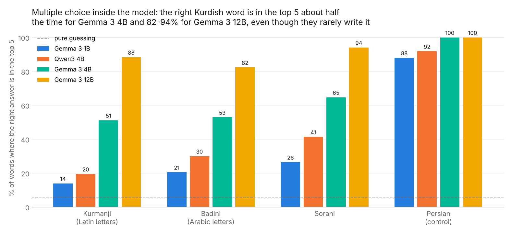
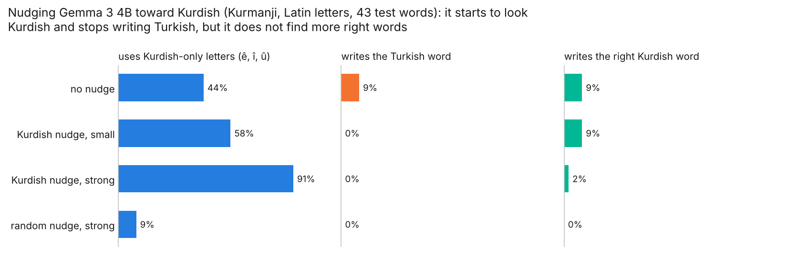

# Experiment 5: When the AI fails to write a Kurdish word, does it secretly know it?

*Written for people who are not programmers.*

---

## 1. The short version

In experiment 4, AI models almost never managed to **write** a Kurdish word (for example, French "eau" → Kurdish "av"), even though they **understood** Kurdish words quite well. That leaves two possibilities:

- **A. The word is there, but locked.** The model knows "av" but something pushes it to write the Turkish or Persian word instead.
- **B. The word is simply not there.** The model knows *that* it should write Kurdish, but it never learned the word.

We tested both, in two ways:

1. **Multiple choice inside the model.** Instead of letting the model write, we showed it a list of possible answers and measured which one it found most likely.
2. **A nudge toward Kurdish.** We found the "Kurdish, not Turkish/Persian" direction inside the model and pushed the model along it while it was writing.

**What we found:**

- **The word is partly there.** In Gemma 3 4B, the right Kurdish word is in the model's top 5 (out of 68–86 choices) for **about half of the words** (51–65%), far above guessing (about 6–7%). Smaller models know much less (14–41%).
- **But the neighbour's word is "louder".** When the model has to choose between the right Kurdish word and the Turkish or Persian word with the same meaning, it prefers the **neighbour's word 85–90% of the time**. For Persian against Arabic (our control) the right word wins 78% of the time.
- **Pushing the model toward Kurdish changes its style, not its vocabulary.** With a strong nudge, **91%** of Gemma's Kurmanji answers used Kurdish-only letters (ê, î, û), up from 44%, and it **stopped writing Turkish words completely**. But it wrote the right word **less** often, not more (from 4 out of 43 down to 1). It made up Kurdish-looking words instead.
- **A 3-times-bigger model knows far more Kurdish words, but still often says the neighbour's.** In Gemma 3 12B the right word is in the top 5 for **82–94%** of the words. For Badini in Arabic letters it knows the word in its top 5 **82%** of the time, but in experiment 4 it *wrote* it only 4 times out of 34, and the Persian word still beats the Badini word **74%** of the time. Here, for the first time, a lot of Kurdish knowledge really is "hidden".

**In one sentence:** the AI knows what Kurdish *looks like* and can be pushed to sound Kurdish, but in small models its Kurdish **dictionary** is thin: the missing words are weakly learned and drowned out by the neighbour language. A bigger model learns the words, but for Badini and Sorani the Persian word is still "louder".

---

## 2. Why this matters

People who want to "fix" an AI for a small language often try cheap tricks: better instructions ("answer in Kurdish!"), or steering the model inside. This experiment suggests that, for Kurdish, those tricks will make the answer **look** more Kurdish without making it more **correct**. The model needs to actually learn more Kurdish words. In AI terms: **the language "style" and the language "vocabulary" are stored separately**, and only the style can be switched on from outside.

This matches a picture that is forming in AI research: models first think in a shared "concept space" (often close to English), and the last layers turn the concept into a word in the target language (see experiment 4 and [Wendler et al. 2024](https://arxiv.org/abs/2402.10588)). For Kurdish, the last step is weak: the model reaches the concept "water", knows the answer should be Kurdish, but the Kurdish word for it is barely learned, so a stronger Turkish or Persian word takes its place.

---

## 3. How we did it

**Words and prompts:** the same as experiment 4. Each prompt shows 5 example word pairs and then asks for the next one, like:
`Français: "eau" - Kurmancî: "`
We tested Kurmanji in Latin letters, Badini in Arabic letters, Sorani, and Persian as a control. The Badini words were checked by a native Badini speaker; the Sorani words were not checked.

**Part A: multiple choice inside the model** (Gemma 3 1B, Gemma 3 4B, Qwen3 4B, Gemma 3 12B)
- For each French word, the candidate answers were *all* the Kurdish words in the list plus all the neighbour-language words (Turkish for Latin-letter Kurmanji, Persian for the Arabic-letter forms). That is 68–86 candidates per question.
- We measured how likely the model finds each candidate.
- Short and common words always look likely, so each word's score was compared with its average score after the *other* French words. This "calibration" asks: is "av" more likely *because the question was "eau"*?

**Part B: the nudge** (Gemma 3 4B)
- We recorded the model's inner state when asked for the Kurdish word, and when asked for the Turkish/Persian word, for the same French word. The average difference is a "Kurdish, not neighbour" direction.
- While the model writes, we add that direction to its inner state, at the middle (layer 17 of 34) or later (layer 23), in three strengths.
- The direction is learned on half of the words and tested on the other half, so the nudge can never carry the answer itself.
- **Control:** a random direction of the same size.

---

## 4. Results

### 4.1 The right word is partly known

| Model | Kurmanji (Latin) | Badini (Arabic letters) | Sorani | Persian (control) |
|---|---|---|---|---|
| Gemma 3 1B | 14% | 21% | 26% | 88% |
| Qwen3 4B | 20% | 30% | 41% | 92% |
| Gemma 3 4B | 51% | 53% | 65% | 100% |
| Gemma 3 12B | **88%** | **82%** | **94%** | 100% |
| *pure guessing* | *6%* | *7%* | *7%* | *5%* |

*Share of words where the right answer is in the model's top 5 choices.*

The right word in **first place** is much rarer: 12%, 9% and 15% for Gemma 3 4B (Persian: 78%). Even for the words Gemma 3 4B **failed to write** in experiment 4, it put the right word first 5–10% of the time, several times the 1–2% expected from guessing. So in the 4B model a little knowledge is "hidden" behind the failure, but not much.

Gemma 3 12B puts the right word first 56% of the time for Kurmanji, 26% for Badini and 29% for Sorani (Persian: 92%). For the words it failed to write in experiment 4, it still puts the right word first 29% (Kurmanji), 17% (Badini) and 10% (Sorani) of the time, against 1–2% for guessing.

### 4.2 The neighbour wins

For each word we also compared the right Kurdish word directly with the neighbour word of the same meaning (for example Kurmanji "av" against Turkish "su"):

| Model | Kurdish word wins: Kurmanji vs Turkish | Badini vs Persian | Sorani vs Persian | *Control: Persian vs Arabic* |
|---|---|---|---|---|
| Gemma 3 1B | 2% | 18% | 6% | 44% |
| Qwen3 4B | 0% | 10% | 7% | 43% |
| Gemma 3 4B | 12% | 9% | 15% | 78% |
| Gemma 3 12B | **58%** | 26% | 29% | 92% |

*After calibration. "Kurdish word wins" = the model links the Kurdish word more strongly to the question than the neighbour word.*

Even when the prompt clearly asks for **Kurdish**, the model links the Turkish or Persian word more strongly to the meaning. This is the "neighbour takeover" of experiment 4, seen now as a measurement and not only in the written answers.

**The bigger model changes this for Kurmanji, but much less for Badini and Sorani.** In Gemma 3 12B, the Kurmanji word beats the Turkish word 58% of the time (4B: 12%), which fits with the 12B model writing half the Kurmanji words correctly in experiment 4. Against Persian, the Badini and Sorani words still lose about 3 times out of 4.

### 4.2b The bigger model's hidden Badini

The clearest case of "known but not said" is Badini in Arabic letters in Gemma 3 12B:

| Gemma 3 12B, Badini (Arabic letters) | |
|---|---|
| Wrote the right word (experiment 4) | 4 of 34 (12%) |
| Right word in its top 5 here | 82% |
| Right word in first place here | 26% |
| Right word beats the Persian word | 26% |

The model has most Badini words somewhere inside, but in the head-to-head the Persian word wins, and in experiment 4 it wrote the Persian word (برف, دریا, گاو, کفش). Size filled in the dictionary; it did not stop the bigger neighbour from winning.

### 4.3 The nudge: Kurdish style, not Kurdish words

For Kurmanji in Latin letters, with the nudge at layer 23:

| | Kurdish-only letters | Wrote the Turkish word | Wrote the right word |
|---|---|---|---|
| No nudge | 44% | 4 of 43 | 4 of 43 |
| Small nudge | 58% | 0 | 4 |
| Strong nudge | **91%** | **0** | 1 |
| Random nudge (control) | 9% | 0 | 0 |

Examples for "mère" (mother; right answer *dayik*): no nudge → *baba* (father); strong nudge → *mê*, *xala* (Kurdish-looking, wrong).

- The nudge clearly does something **specific to Kurdish**: the random push of the same strength destroys the Kurdish look (9%), while the Kurdish push raises it to 91%.
- It removes the Turkish words completely.
- It does **not** add right answers. At full strength it loses some.

For the Arabic-letter forms (Badini and Sorani) the nudge did nothing useful: the answers already looked Kurdish (71–85% used Kurdish-only letters such as ێ, ۆ, ە), and the number of right words did not go up at any strength (Badini: at most 2 of 34, Sorani: at most 4 of 34).

---

## 5. What does it mean?

1. **Two separate things are stored: "write in Kurdish" and "the Kurdish word for X".** The first is strong and can be switched on from outside. The second is weak.
2. **Failure to write is mostly real missing knowledge, not a locked door.** Some knowledge is hidden (top-5 about half the time in the best model), but it is not enough to win against the neighbour language.
3. **Bigger models know much more.** From Gemma 3 1B to 4B to 12B, the right Kurmanji word is in the top 5 for 14%, 51% and 88% of the words. Size fills the dictionary.
4. **But knowing the word is not the same as saying it.** In Gemma 3 12B the Badini words are mostly known (82% in the top 5) yet mostly not written (12%), because the Persian word is still stronger. For Kurmanji, where the 12B model's Kurdish word finally beats the Turkish one, it also writes half the words right. Whether the AI *says* Kurdish depends on the contest with the neighbour, not only on what it knows.
5. **The fix is more Kurdish training text, not clever prompting.** Prompts and nudges that "push toward Kurdish" will mainly produce Kurdish-looking words, some of them invented.

---

## 6. Honest limits

- **Small word list**: 34–43 test words per form (the words where the model already understood the French word). Small differences (for example 9% vs 12%) are not meaningful; large ones (6% vs 51%, 12% vs 78%) are.
- **One correct spelling per word** in the multiple choice. Some Kurdish words have several valid forms; a model that "knows" another form is counted as wrong. This makes the numbers a little too low.
- **The Sorani words were not checked by a native speaker.**
- **Steering was tested on one model only** (Gemma 3 4B), at two layers and three strengths. Other ways of steering might work better.
- **Models of 1–12 billion parameters** (the 12B one run with 8-bit weights). The largest commercial models are much bigger and may know far more Kurdish words.
- **The steering test (Part B) was not repeated on the 12B model.**

---

## 7. Files

| File | What it is |
|---|---|
| `experiment/hidden_knowledge.py` | Runs Part A and Part B (saves progress, so it can be stopped and restarted) |
| `experiment/hidden_knowledge_charts.py` | Makes the charts |
| `results/hidden_knowledge/<model>.json` | All the numbers |
| `results/hidden_knowledge/gemma3-4b_steer_samples.txt` | Every word Gemma wrote, with and without the nudge |
| `charts/hidden_knowledge/*.png` | The charts |

**To run it:** `cd experiment && python hidden_knowledge.py gemma3-4b qwen3-4b gemma3-1b gemma3-12b && python hidden_knowledge_charts.py` (needs the results of experiment 4; several hours on a normal computer, about 6 hours for the 12B model).
