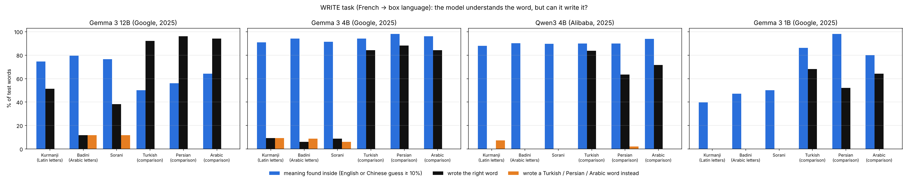
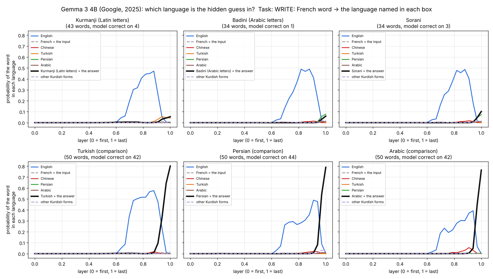
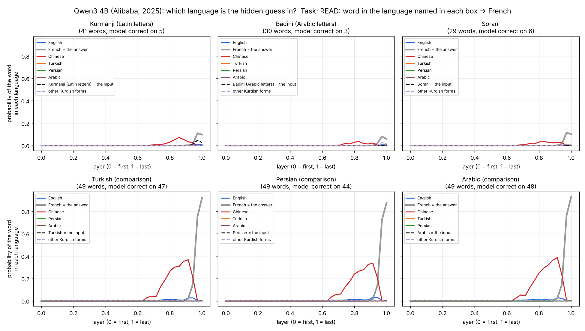
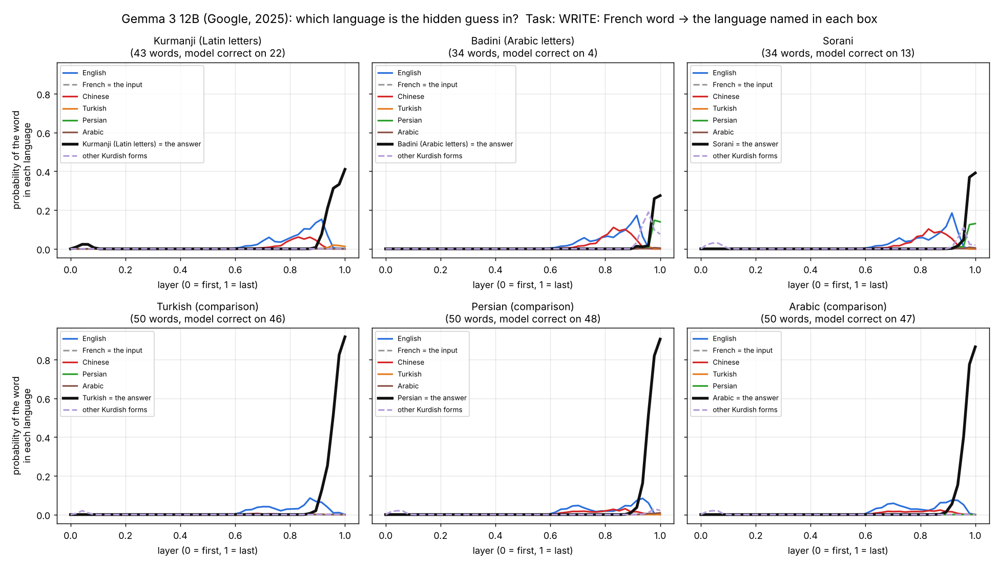

# Experiment 4: Which language does an AI "think in" when it writes Kurdish?

*A new experiment, written for people who are not programmers.*

---

## 1. The short version

- A well-known 2024 study found that many AI models **quietly pass through English in their middle layers**, even when they translate between two other languages. We asked a new question: **what happens with Kurdish?** Kurdish has no state of its own and is surrounded by Turkish, Persian and Arabic. Inside the AI, does Kurdish get swallowed by its neighbours?
- We tested 3 modern models (Gemma 3 from Google, Qwen3 from Alibaba) on 60 everyday words in **Kurmanji (Latin letters)**, **Badini (Arabic letters)** and **Sorani**, with Turkish, Persian and Arabic as comparison languages.
- **Answer 1: in the middle, Kurdish is treated like every other language.** Gemma "thinks" in **English** and Qwen "thinks" in **Chinese**, for Turkish, Persian, Arabic and Kurdish alike. Kurdish is not swallowed by Turkish or Persian *inside the thinking*.
- **Answer 2: writing Kurdish breaks at the very last step.** When asked to write a Kurdish word, the best model understands the meaning for **9 out of 10 words**, but writes the right Kurdish word for **fewer than 1 in 10**. For Turkish, Persian and Arabic it gets **84–88%** right.
- **Answer 3: at that last step, the neighbours move in.** When the model fails, it often reaches for the neighbouring language. Asked for Kurmanji it wrote the **Turkish** words *el, baş, kan, gece* (hand, head, blood, night). Asked for Badini or Sorani it wrote the **Persian** words *gav, dost, kitab*. In the final layer, the Persian word usually gets **more** probability than the correct Badini or Sorani word.
- **Answer 4: reading Kurdish breaks earlier.** When a model fails to read a Kurdish word, the meaning never appears inside it at all. When it succeeds, the meaning appears just as strongly as for Turkish.
- **Answer 5: the alphabet matters.** On the 30 words tested in all three Kurdish forms, the best model read **13** correctly in Latin letters but only **7** when the *same Badini words* were written in Arabic letters.

- **Answer 6: a 3-times-bigger model writes much more Kurdish, but not Badini.** Gemma 3 12B writes the right Kurmanji word for **51%** of the words (the 4B model: 9%) and Sorani for **38%** (4B: 9%). Badini in Arabic letters stays almost as bad: **12%** (4B: 6%). There, the Persian word still takes over.

---

## 2. Has anyone done this before?

We searched before starting. The "AI thinks in English" result is from [Wendler et al. 2024, "Do Llamas Work in English?"](https://arxiv.org/abs/2402.10588). Later studies looked at [Japanese](https://aclanthology.org/2025.findings-acl.1350.pdf), [Urdu](https://arxiv.org/abs/2502.00041), [Indian languages written in Latin letters](https://arxiv.org/abs/2502.07424), [Serbian in two alphabets](https://arxiv.org/abs/2603.08869) and [how models choose an alphabet](https://arxiv.org/abs/2605.31363). As far as we could find:

- **nobody has looked inside an AI model at Kurdish**, and
- **nobody has asked whether a small language gets replaced by its *neighbouring* languages** (rather than by English) inside a model, or
- **compared the same dialect (Badini) in two alphabets** for a stateless language.

Our searches were careful but not a full literature review, so it is possible that something similar exists.

---

## 3. New words (one sentence each)

| Word | Meaning |
|---|---|
| **Logit lens** | A trick for reading the model's half-finished thoughts: at any layer, we pretend the model has to answer *now* and see which word it would pick. |
| **Hidden guess** | What the logit lens shows at a layer: the word (and language) the model is leaning towards at that point. |
| **Hidden language** (or "latent language") | The language the hidden guesses are in, in the middle of the model. |
| **Few-shot prompt** | Showing the model 5 example translations first, so it understands the task. |
| **Neighbour language** | Turkish, Persian or Arabic: the big languages around Kurdistan. |

---

## 4. What we did

1. **The words.** We wrote 70 everyday words (water, bread, mother, mountain, wolf…) in 9 forms: English, French, Chinese, Turkish, Persian, Arabic, Kurmanji (Latin letters), Badini (Arabic letters, as written in Duhok) and Sorani. 10 words were used only as examples inside the prompt, and 60 were tested. (See `experiment/latent_words.py`.)
2. **Fair counting.** Many Kurdish words look like their Persian or Turkish cousins (Sorani and Persian *baran*, "rain"). If two languages' words start with the same piece, we can't tell them apart, so **those words were left out** for that test. This left 29–50 words per test.
3. **Two tasks.**
   - **WRITE:** `Français: "eau" - Kurmancî: "` → the model must write the Kurdish word.
   - **READ:** `Kurmancî: "av" - Français: "` → the model must translate the Kurdish word into French.
   We used French as the "other side" so that English, Turkish, Persian and Arabic are not in the prompt at all.
4. **Comparison languages.** Exactly the same tasks for Turkish, Persian and Arabic.
5. **Looking inside.** At every layer, we used the logit lens to measure how likely the right word is in **each** language: English, Chinese, French, Turkish, Persian, Arabic and the Kurdish form. Each test word was asked with 3 different sets of examples, and we averaged.
6. **What the model really writes.** We also let it write the answer and checked which language it came out in.
7. **Models:**

| Model | Made by | Year | Size | Layers |
|---|---|---|---|---|
| Gemma 3 4B | Google | 2025 | 4,000M | 34 |
| Qwen3 4B | Alibaba | 2025 | 4,000M | 36 |
| Gemma 3 1B | Google | 2025 | 1,000M | 26 |

We first tried Qwen2.5-0.5B, but it was too small to translate at all (4 of 49 Turkish words right), so we moved to bigger models. Gemma 3 was loaded from an exact free copy of Google's files, so no sign-up was needed.

---

## 5. What we found

### 5.1 In the middle, the model thinks in English (or Chinese), for Kurdish too

Each box is one target language. The **blue line** is the English word, and the **thick black line** is the right answer.

- In **every** box, the blue English line rises in the second half of the model, to about **50%**, and then falls. So while translating French "eau" into Kurmanji, Gemma first lands on English "water" internally. This is the "thinks in English" effect, and it happens for Kurdish exactly as for Turkish.
- The Turkish, Persian and Arabic lines stay near **zero** in the middle. **Kurdish is not routed through its neighbours inside the thinking.**
- **Qwen3 thinks in Chinese instead** (red line, about 45–65%), again for all languages including Kurdish. Qwen is made by a Chinese company and trained on a lot of Chinese text. (See `charts/latent_language/qwen3-4b_write.png`.)

How strong is the hidden meaning? (Highest point of the hidden-language line, averaged over words, WRITE task):

| Model (hidden language) | Kurmanji | Badini | Sorani | Turkish | Persian | Arabic |
|---|---|---|---|---|---|---|
| Gemma 3 4B (English) | 57% | 57% | 57% | 70% | 60% | 52% |
| Qwen3 4B (Chinese) | 44% | 52% | 55% | 58% | 64% | 61% |
| Gemma 3 1B (English) | 17% | 16% | 18% | 53% | 38%* | 30%* |

*\*Gemma 3 1B also partly uses Chinese for Persian and Arabic.*

In the 4B models the meaning is **about as strong for Kurdish as for the big languages**. The small 1B model is different: when the target is Kurdish, even the meaning becomes weak.

### 5.2 Writing Kurdish breaks at the very last step

Look at the black lines in the chart above. For Turkish, Persian and Arabic, the answer shoots up to about **80%** in the last few layers. For Kurdish, it barely gets off the floor (5–10%).

How often the model **wrote** the right word:

| Model | Kurmanji | Badini | Sorani | Turkish | Persian | Arabic |
|---|---|---|---|---|---|---|
| Gemma 3 4B | **4 / 43** | **2 / 34** | **3 / 34** | 42 / 50 | 44 / 50 | 42 / 50 |
| Qwen3 4B | **0 / 41** | **0 / 30** | **0 / 29** | 41 / 49 | 31 / 49 | 35 / 49 |
| Gemma 3 1B | **0 / 43** | **0 / 34** | **0 / 34** | 34 / 50 | 26 / 50 | 32 / 50 |

Put simply: **the model knows what you mean, but it does not have the Kurdish word.** Its knowledge of the *meaning* is fine; its *Kurdish dictionary* at the output end is nearly empty.

### 5.3 …and at that last step the neighbours move in

When the model has no Kurdish word, what does it write?

**Gemma 3 4B, asked for Kurmanji, wrote Turkish:**

> hand → **el** (Turkish), head → **baş** (Turkish), blood → **kan** (Turkish), night → **gece** (Turkish)

**Gemma 3 4B, asked for Badini or Sorani, wrote Persian:**

> cow → **گاو** *gav* (Persian), friend → **دوست** *dost* (Persian), book → **کتاب** *kitab* (Persian)

**Qwen3 4B often wrote the French input "dressed up" in Kurdish letters:**

> door → **پورت** (French *porte*), song → **چانسون** (French *chanson*), love → **ئامور** (French *amour*), salt → **سیل** (French *sel*), night → **نیت** (French *nuit*)

The last-layer numbers show the same thing. This is the probability of the right word compared with the neighbour's word, at the final layer, in the WRITE task:

| Model | Kurmanji vs **Turkish** | Badini vs **Persian** | Sorani vs **Persian** |
|---|---|---|---|
| Gemma 3 4B | 5.4% vs 4.3% | 6.3% vs **7.7%** | 10.2% vs 7.2% |
| Qwen3 4B | 1.9% vs **2.6%** | 4.6% vs **9.7%** | 4.6% vs **7.3%** |
| Gemma 3 1B | 1.6% vs **1.7%** | 2.7% vs **5.6%** | 3.3% vs **4.3%** |

In **7 of 9** cases the **neighbour's word is more likely than the correct Kurdish word**. For comparison, when the model writes Turkish, the Kurdish words get less than 1%. The leak goes one way: from the big neighbour into Kurdish, not back.

Notice also that **the neighbour depends on the alphabet.** Kurmanji in Latin letters leaks into **Turkish** (also Latin letters). Badini, the *same dialect* written in Arabic letters, leaks into **Persian**. The model chooses the neighbour by **how the word looks**, not by which language it really is.

### 5.4 Reading Kurdish breaks earlier: the meaning never forms

In the READ task (Kurdish → French), how often the model got the right French word:

| Model | Kurmanji | Badini | Sorani | Turkish | Persian | Arabic |
|---|---|---|---|---|---|---|
| Gemma 3 4B | 19 / 43 | **9 / 34** | 18 / 34 | 48 / 50 | 47 / 50 | 49 / 50 |
| Qwen3 4B | 3 / 41 | 4 / 30 | 6 / 29 | 47 / 49 | 44 / 49 | 48 / 49 |
| Gemma 3 1B | 0 / 43 | 1 / 34 | 2 / 34 | 37 / 50 | 39 / 50 | 42 / 50 |

Looking word by word in Gemma 3 4B shows something clear:

| Gemma 3 4B, READ task | Hidden English meaning when the answer was **wrong** | …when the answer was **right** |
|---|---|---|
| Kurmanji | 5% | 48% |
| Badini (Arabic letters) | 6% | 56% |
| Sorani | 1% | 56% |
| Turkish (comparison) | 14% | 50% |

So reading works the same way for every language: **if the model understands a Kurdish word, the meaning appears inside just as strongly as for Turkish.** When it fails, nothing appears. There is no "half understanding" through Persian or Turkish either. Those lines stay at zero.

When Gemma could not read a Badini word, it most often answered ***chien*** ("dog"). That is one of the example answers shown in the prompt. With nothing to go on, it simply copies an example.

### 5.5 The alphabet matters: Badini in Latin vs Arabic letters

Badini is usually written in Arabic letters in Duhok, while the Kurmanji standard uses Latin letters. We tested the same words both ways:

- **Reading:** to make it fair, we used only the 30 words (24 for Qwen) that were tested in all three Kurdish forms:

| Model | Badini in **Latin** letters | Badini in **Arabic** letters | Sorani (Arabic letters) |
|---|---|---|---|
| Gemma 3 4B (30 words) | **13** | **7** | 15 |
| Qwen3 4B (24 words) | 3 | 3 | 5 |

  For the stronger model, Gemma, the same words in the same dialect are read about **half as well** in Arabic letters. (Qwen reads too few Kurdish words to show a difference.) Sorani, also in Arabic letters, does at least as well as Latin-letter Kurmanji, probably because there is much more Sorani than Arabic-letter Badini on the internet.
- **Writing**: as shown above, the alphabet decides which neighbour leaks in (Turkish for Latin letters, Persian for Arabic letters).

For an AI, **Badini in Arabic letters is the hardest form of Kurdish of all**, even though for people in Duhok it is the most natural.

### 5.6 A bigger model: Gemma 3 12B

We repeated everything with **Gemma 3 12B**, three times the size of Gemma 3 4B (48 layers). It is too big for this computer's memory in full precision, so its weights were rounded to 8-bit numbers (about 12 GB). This changes a model's answers very little.

**Writing** (French → the language):

| | Kurmanji | Badini (Arabic letters) | Sorani | Turkish | Persian | Arabic |
|---|---|---|---|---|---|---|
| Gemma 3 4B | 4 / 43 (9%) | 2 / 34 (6%) | 3 / 34 (9%) | 42 / 50 | 44 / 50 | 42 / 50 |
| **Gemma 3 12B** | **22 / 43 (51%)** | **4 / 34 (12%)** | **13 / 34 (38%)** | 46 / 50 | 48 / 50 | 47 / 50 |

**Reading** (the language → French), on the 30 words tested in all three Kurdish forms:

| | Badini in Latin letters | Badini in Arabic letters | Sorani |
|---|---|---|---|
| Gemma 3 4B | 13 | 7 | 15 |
| **Gemma 3 12B** | **19** | **18** | **22** |

**The neighbour at the last step** (average probability of the right word vs the neighbour's word, last layer):

| | Kurmanji vs Turkish | Badini vs Persian | Sorani vs Persian |
|---|---|---|---|
| Gemma 3 4B | 5.4% vs 4.3% | 6.3% vs **7.7%** | 10.2% vs 7.2% |
| **Gemma 3 12B** | **41% vs 1.2%** | 27% vs **14%** | 39% vs **13%** |

What changes with size:

- **Kurmanji in Latin letters is "fixed" the most.** Half the words are now right, and the Turkish words disappear completely.
- **Badini in Arabic letters is left behind.** The bigger model *reads* Arabic-letter Badini almost as well as Latin-letter Badini (18 vs 19). But it still *writes* only 4 of 34 right. It often wrote the Persian word, spelled the Persian way: برف (snow), دریا (sea), گاو (cow), کفش (shoe). In the last layer, Persian still gets about half as much probability as the right Badini word.
- **Understanding grows faster than writing.** For Badini, the 12B model understands most words but writes few. The gap between "knows the meaning" and "can say it in Kurdish" is the same gap as in the smaller models, just at a higher level.
- **The hidden English is weaker.** In the 12B model, the English hidden guess in the middle is smaller (about 20% instead of about 57%). It still appears before the answer in every language. Interestingly, it is a little *stronger* for Kurdish (about 21%) than for Turkish, Persian and Arabic (about 13%). The bigger model may go through English mostly when the word is hard for it.

---

## 6. What does it mean?

1. **The models do not "think in Turkish" or "think in Persian" when they handle Kurdish.** In the middle they use one central language (English for Gemma, Chinese for Qwen), for every language. In that sense Kurdish is treated as equal *inside*.
2. **The inequality is at the edges.** Going *in* (reading) and coming *out* (writing), the models are missing Kurdish. They understand much less, and they can hardly write a Kurdish word at all, even a word as simple as "water" or "mother".
3. **When a Kurdish word is missing, the neighbour fills the gap.** Turkish for Latin letters and Persian for Arabic letters. This is the AI version of something Kurdish speakers know well: a stateless language being replaced by the state languages around it. In experiment 3 we saw a model call Kurdish food "Turkish cuisine". Here we see the same thing happening to single words.
4. **This is a good sign for fixing it.** The meaning is already there. What is missing is the last step: the link from meaning to Kurdish words. That is a much smaller problem than teaching the model a whole new language, and it suggests that a modest amount of good Kurdish text, especially Badini, could help a lot.
5. **A bigger question.** These results support the idea that meaning inside these models lives in a shared space that does not belong to any one language. Each language is only a "door" in and out. Kurdish is in the house, but its doors are very small.

---

## 7. Honest limits

- **The Kurdish words were first written by an AI (Claude).** The Badini words (Arabic letters) were then checked and corrected by a native Badini speaker, and the Latin-letter column was changed to match. The results above use the corrected list. **The Sorani words have not been checked by a native speaker** and may contain mistakes.
- **Mostly one right answer per word.** Only "bird" has several accepted forms (*çûçik / çwîçik / çîçik*). The model sometimes wrote another real Kurdish word (for example *kitêb* for "book" instead of *pirtûk*) and was marked wrong. So the real writing scores may be slightly higher. But this cannot explain 0–9% against 84%.
- **The logit lens is a rough tool.** It reads the model's thoughts through its final output step, which is not designed for the middle layers. Later research has better tools (for example the "tuned lens"). The patterns we see (English/Chinese in the middle, a jump at the end) match the 2024 study, which gives some confidence.
- **We only count the first piece of each word.** Two languages whose words start with the same piece were left out, which removed many Persian–Kurdish cousin words. This makes the test fair but means the "neighbour" numbers are probably *lower* than the truth.
- **Only 4 models, the biggest with 12 billion parameters**, because we ran everything on an ordinary computer with no graphics card. The 12B model was run with 8-bit weights. Bigger commercial models (like ChatGPT or Claude) probably know much more Kurdish; section 5.6 shows how fast it grows with size.
- **60 simple words, one prompt style.** Sentences, grammar and rarer words were not tested.
- **The "neighbour" counts only include our exact word list.** A Persian or Turkish word that is not in our list was counted as "other".

---

## 8. Ideas for next time

1. **A fuller native-speaker word list.** Have a Sorani speaker check the Sorani column too, and add the common alternative forms for every word (for example *pirtûk* and *kitêb*).
2. **Prove the "last step" idea with surgery.** Take the hidden English meaning from a sentence where the model *does* know the Kurdish word and plant it into one where it doesn't. If the problem really is only the last step, this won't help, because the meaning is already there.
3. **Teach it the last step.** Fine-tune a small model on a little Badini text (for example only the last few layers) and see whether the Kurdish words appear without the rest of the model changing. This connects directly to building Badini AI tools.
4. **Other stateless and small languages:** Zazaki, Hawrami, Assyrian (Neo-Aramaic) or Tamazight. Do their neighbours leak in too?

---

## 9. Files

| File | What it is |
|---|---|
| `experiment/latent_words.py` | The 70 words in 9 language forms (Badini checked by a native speaker; Sorani not yet checked) |
| `experiment/latent_language.py` | The experiment: prompts, logit lens, counting |
| `experiment/latent_language_charts.py` | Makes the charts |
| `results/latent_language/<model>.json` | All the numbers, including every word at every layer |
| `results/latent_language/<model>_samples.txt` | Every answer each model wrote |
| `charts/latent_language/<model>_write.png`, `<model>_read.png` | Layer-by-layer charts for each model |
| `charts/latent_language/meaning_vs_word.png` | The main chart: understood vs written |
| `charts/latent_language/summary_middle_layers_*.png` | Which language the hidden guess is in, in the middle of each model |

**To run it:** `cd experiment && python latent_language.py all && python latent_language_charts.py`. It downloads about 20 GB of models and took about 1.5 hours on a normal computer with no graphics card (4 cores, 16 GB memory).
