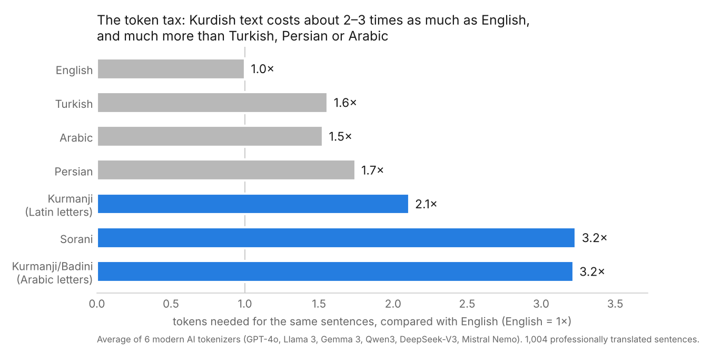
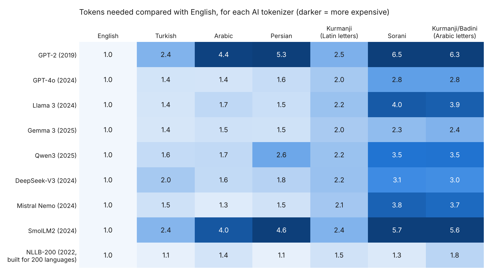

# Experiment 6: The "token tax" on Kurdish

*Written for people who are not programmers.*

---

## 1. The short version

- An AI does not read letters or words. It reads **tokens**: pieces of text from a fixed list that was made before the AI was trained. A language that the list was not built for gets chopped into many small pieces.
- We took **1,004 sentences**, professionally translated into English, Turkish, Persian, Arabic, Sorani and Kurmanji, and counted how many tokens each one costs in **9 AI tokenizers**, including the ones used by GPT-4o, Llama 3, Gemma 3, Qwen3, DeepSeek-V3 and Mistral.
- **Kurdish pays a heavy tax.** In today's models, the same text costs on average:
  - **2.1×** as many tokens as English in Kurmanji (Latin letters),
  - **3.2×** in Sorani,
  - **3.2×** in Kurmanji/Badini written in Arabic letters,
  - but only **1.5–1.7×** in Turkish, Arabic and Persian.
- **The same alphabet does not save you.** Sorani uses almost the same letters as Persian, but costs on average **1.9 times as many tokens as Persian** (up to 2.6× in Llama 3 and Mistral).
- **Badini in Arabic letters costs about 1.5 times as much as the same words in Latin letters.** Duhok's usual way of writing is the most expensive one.
- **It can be fixed.** NLLB, a translation model from Meta built for 200 languages, cuts Kurdish into only 1.3–1.8× the English amount, close to Turkish and Persian. The tax comes from choices made when the token list was built, not from the Kurdish language itself.

---

## 2. Why this matters

Tokens are the "currency" of AI:

- **Money.** AI services charge per token. A Sorani user pays about **3 times** what an English user pays for the same text, and about **twice** what a Persian user pays.
- **Memory.** A model can only look at a fixed number of tokens at once. In Sorani, a document fills that memory three times faster, so the model "remembers" only a third as much of it.
- **Speed.** The AI writes one token at a time, so Kurdish answers are slower.
- **Quality.** When a word is chopped into many meaningless pieces, the model has to rebuild the word from fragments. In experiment 4 we saw that models struggle to *write* Kurdish words. Being chopped into small pieces is likely part of the reason: in today's models, **59%** of Sorani words and **48%** of Arabic-letter Badini words are cut into **4 or more pieces**. For English it is **2%**, for Persian **12%**.

---

## 3. Has this been done before?

Yes, in general. [Petrov et al. 2023](https://arxiv.org/abs/2305.15425) and [Ahia et al. 2023](https://arxiv.org/abs/2305.13707) showed that the same text costs very different amounts in different languages, using older tokenizers. A 2026 paper on Sorani speech translation looked at Sorani against English ([arXiv 2604.00613](https://arxiv.org/abs/2604.00613)).

What is new here, as far as we could find:

1. Kurdish measured against its **own neighbours** (Turkish, Persian, Arabic), not only against English, in **2024–2025 tokenizers**.
2. **The same dialect in two alphabets**: Kurmanji/Badini in Latin letters against the same sentences in Arabic letters.

---

## 4. How we did it

- **Sentences:** the 1,004 sentences of SIB-200 ([Adelani et al. 2024](https://arxiv.org/abs/2309.07445)), which come from the FLORES-200 test set. Each sentence was translated by professional translators into every language, so the meaning is the same everywhere. The sentences are mostly news and Wikipedia-style text.
- **Badini in Arabic letters:** there is no professional Arabic-letter version of these sentences, so we converted the Kurmanji sentences letter by letter with simple rules (`experiment/kurdish_script.py`). On the 70 words checked by a native Badini speaker in experiment 4, the rules give exactly the right spelling for **62 of 70**. Most misses are the heavy sounds ڵ and ڕ, which Latin letters do not show.
- **Tokenizers:** GPT-2 (2019), GPT-4o (2024), Llama 3 (2024), Gemma 3 (2025), Qwen3 (2025), DeepSeek-V3 (2024), Mistral Nemo (2024), SmolLM2 (2024), and NLLB-200 (2022) as an example of a tokenizer built on purpose for many languages. Only the token lists were downloaded, not the models.
- **The measure:** the total number of tokens for all 1,004 sentences, divided by the number for English.

---

## 5. Results

### 5.1 Kurdish is the most expensive language in every modern tokenizer

In every one of the 6 modern tokenizers, Sorani and Arabic-letter Badini cost more than any of Turkish, Persian or Arabic. Gemma 3 is the "fairest" of the big ones (2.0–2.4×). Llama 3 and Mistral Nemo are the worst (3.7–4.0× for Arabic-letter Kurdish).

### 5.2 Sorani vs Persian: same alphabet, twice the price

| Tokenizer | Sorani costs … × Persian |
|---|---|
| GPT-4o | 1.7× |
| Llama 3 | 2.6× |
| Gemma 3 | 1.6× |
| Qwen3 | 1.3× |
| DeepSeek-V3 | 1.7× |
| Mistral Nemo | 2.6× |
| NLLB-200 (built for 200 languages) | 1.2× |

The token lists learned Persian words, but not Kurdish words, even though they are written with almost the same letters. Kurdish-only letters like ێ, ۆ, ڵ, ڕ and ە make it worse: they split words in places where Persian would not.

### 5.3 The same Badini words: Latin letters vs Arabic letters

| Tokenizer | Arabic letters cost … × Latin letters |
|---|---|
| GPT-4o | 1.4× |
| Llama 3 | 1.8× |
| Gemma 3 | 1.2× |
| Qwen3 | 1.6× |
| DeepSeek-V3 | 1.4× |
| Mistral Nemo | 1.8× |

Latin-letter Kurmanji borrows a lot from Turkish, which the token lists know well, because both use almost the same letters (Kurmanji adds ê, î and û). Arabic-letter Badini gets no such help.

### 5.4 Kurmanji vs Turkish

Even in Latin letters, Kurmanji costs on average **1.4×** as much as Turkish. The shared alphabet helps, but the token lists still learned Turkish words, not Kurdish ones.

### 5.5 Newer is not always fairer

GPT-2 (2019) was terrible for every non-English language (Persian 5.3×, Sorani 6.5×). Modern tokenizers improved a lot for Turkish, Persian and Arabic (down to about 1.5×), but much less for Kurdish: Sorani still costs 2.3–4.0×. **The gap between Kurdish and its neighbours is bigger today than it was in 2019**, measured as Sorani compared with Persian (1.2× in GPT-2, about 1.9× in modern tokenizers on average).

---

## 6. What does it mean?

1. **Kurdish speakers pay more for worse service.** The same request costs more, fits less into the model's memory, and is likely understood worse.
2. **The tax is a design choice.** NLLB shows that a token list can treat Kurdish almost as well as Turkish or Persian. The big AI companies built their token lists mostly from the text they had, and there is little Kurdish text on the internet. Kurdish was left out of the list from the start, before any training happened.
3. **For Badini, the alphabet matters.** Text written the way people in Duhok usually write it is the most expensive form of Kurdish for an AI. This matches experiment 4, where Arabic-letter Badini was also the hardest form for the AI to read and write.
4. **A practical tip:** for now, if you use an AI for Kurmanji/Badini, Latin letters are cheaper and (from experiment 4) better understood.

---

## 7. Honest limits

- **The Arabic-letter Badini text was converted by rules**, not written by people. Real Badini writing may differ a little (for example ڵ, ڕ, and spelling habits). The token counts should be close, but not exact.
- **News and Wikipedia-style sentences only.** Everyday chat may give different numbers.
- **Tokens are not quality.** A higher token count usually goes with worse results, but this experiment measures only the cost, not how well the models understand.
- **Commercial tokenizers change.** GPT-4o's token list was taken from a public copy (`Xenova/gpt-4o`); newer commercial models may use different lists.

---

## 8. Files

| File | What it is |
|---|---|
| `experiment/token_tax.py` | Downloads the sentences, counts tokens |
| `experiment/kurdish_script.py` | Converts Kurmanji from Latin letters to Arabic letters (and tests the rules on the checked word list) |
| `experiment/token_tax_charts.py` | Makes the charts |
| `results/token_tax/token_tax.json` | All the numbers, for every tokenizer and language |
| `charts/token_tax/*.png` | The charts |

**To run it:** `cd experiment && python token_tax.py && python token_tax_charts.py` (a few minutes; downloads only small files).
