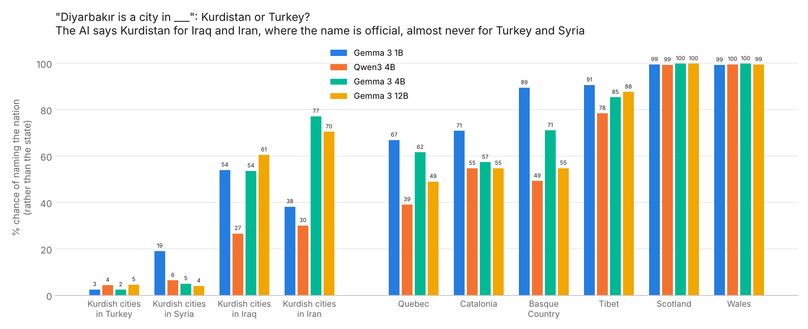

# Experiment 7: "Whose is it?" Does the AI give Kurdish people, places and culture their Kurdish name?

*Written for people who are not programmers.*

---

## 1. The short version

Kurds have no state of their own. Kurdish people, cities and culture are usually described in the world's texts by the **state** they live in: Turkey, Iraq, Iran or Syria. We asked whether AI models copy this.

We did not let the models write freely. Instead, we gave them the start of a sentence and measured how likely they found each possible ending. We did this for four models: GPT-2 (2019), Gemma 3 1B, 4B and 12B (Google, 2025) and Qwen3 4B (Alibaba, 2025).

**What we found:**

- **The AI knows the Kurdish names.** Asked for the Kurdish name of Diyarbakır, Erbil or Sanandaj, the biggest model picks the right one (*Amed*, *Hewlêr*, *Sine*) for **14 of 15 cities**, even when the Kurdish name looks nothing like the official one.
- **But it hardly ever says a Kurdish city in Turkey or Syria is in Kurdistan.** For "Diyarbakır is a city in ___", the chance of "Kurdistan" rather than "Turkey" is **2–5%** in all four modern models. For Kurdish cities in **Syria** it is **4–19%**.
- **For Iraq and Iran it is very different: 27–77%.** These are the two states where "Kurdistan" is an **official name**: the Kurdistan Region in Iraq and Kurdistan Province in Iran. The AI says "Kurdistan" where a government uses the word, and almost never where it does not.
- **Other nations without a state are treated much better.** Barcelona is "in Catalonia" (55–71%), Lhasa "in Tibet" (78–91%), Bilbao "in the Basque Country" (49–89%), Edinburgh "in Scotland" (99–100%).
- **Smaller models describe Kurdish people by their state.** Şivan Perwer, Ahmet Kaya, Yılmaz Güney, Sherko Bekas: the 1–4B models call most famous Kurds "Turkish", "Iranian" or "Arab". Only **10–30%** are called Kurdish. Turkish, Persian and Arab public figures are named correctly **89–100%** of the time.
- **The bigger model fixes the people, but not the map.** Gemma 3 12B calls **9 of 10** famous Kurds Kurdish when asked about their origin. But it still almost never says a Kurdish city in Turkey (5%) or Syria (4%) is in Kurdistan. Size taught it *who* is Kurdish, not *where* Kurdistan is.

**In one sentence:** the AI *knows* Kurdish names and Kurdish facts, but when it describes Kurdish people and places, it uses the names that states use. Where a state does not say "Kurdistan" or "Kurdish", the AI mostly does not either.

---

## 2. Why this matters

When millions of people ask an AI about a place or a person, the AI's default words become the world's default words. For Kurds, whether the AI says "Kurdistan" or "Kurdish" depends almost entirely on which **state** they live in. For about half of all Kurds, those living in Turkey and Syria, the AI almost never uses those words.

This is not about whether one name is "right". "Diyarbakır is a city in Turkey" is true. "Diyarbakır is a city in Kurdistan" is also how many people, Kurds and others, describe it. The point is that the AI's choice **follows official state language**. It does not follow how the people themselves name their home. And it does not treat other stateless nations like Catalans, Basques, Tibetans or Scots this way.

---

## 3. How we did it

No text is generated. For each sentence start, we measured how likely the model finds each ending, and report the share that goes to the Kurdish answer.

**Part 1: People and culture.** "Şivan Perwer is a famous ___ singer": Kurdish, Turkish, Iranian, Persian, Arab, Iraqi, Syrian or Armenian?
- 10 well-known Kurdish people (singers, film directors, poets, Saladin), 4 pieces of Kurdish culture (Mem and Zin, dengbêj, govend, şal û şapik).
- **Controls:** 9 Turkish, Persian and Arab public figures, and 3 pieces of their culture.
- **Two ways of asking:**
  - "a famous ___ singer": this could also mean *citizenship*, where "Turkish" is not wrong.
  - "a singer of ___ origin": here the answer should clearly be Kurdish.

**Part 2: Kurdish city names.** 'In Kurdish, the city of Diyarbakır is called "___"'. This is multiple choice among the Kurdish names of 15 cities, with the same fairness correction as in experiment 5. 6 of the 15 Kurdish names look nothing like the official name (Amed, Hewlêr, Sine, Dêrsim, Êlih, Colemêrg), so the model cannot just copy the spelling.

**Part 3: Naming the homeland.**
- Three sentence starts: "X is a city in ___", "X is the largest city in ___" and "The city of X lies in ___". The two endings compared were the nation and the state.
- 21 Kurdish cities: 6 in Turkey, 4 in Syria, 6 in Iraq and 5 in Iran.
- **Controls:** 8 cities in 6 other nations without their own state.

---

## 4. Results

### 4.1 The Kurdish city names are known

| Model | Right Kurdish name, all 15 cities | Only the 6 names that look different |
|---|---|---|
| GPT-2 (2019) | 60% | 17% |
| Gemma 3 1B | 67% | 33% |
| Qwen3 4B | 80% | 50% |
| Gemma 3 4B | 87% | 83% |
| Gemma 3 12B | **93%** | **83%** |
| *pure guessing* | *7%* | *7%* |

Gemma 3 4B knows that Diyarbakır is *Amed*, Erbil is *Hewlêr*, Sanandaj is *Sine*, Tunceli is *Dêrsim* and Hakkari is *Colemêrg*.

### 4.2 "Kurdistan" depends on the state

*Chance of naming the nation rather than the state, averaged over the cities and the three sentence starts.*

| | GPT-2 | Gemma 3 1B | Qwen3 4B | Gemma 3 4B | Gemma 3 12B |
|---|---|---|---|---|---|
| Kurdish cities in **Turkey** (6) | 5% | 3% | 4% | 2% | 5% |
| Kurdish cities in **Syria** (4) | 16% | 19% | 6% | 5% | 4% |
| Kurdish cities in **Iraq** (6) | 15% | 54% | 27% | 54% | 61% |
| Kurdish cities in **Iran** (5) | 7% | 38% | 30% | 77% | 70% |
| Catalonia | 19% | 71% | 55% | 57% | 55% |
| Basque Country | 3% | 89% | 49% | 71% | 55% |
| Quebec | 64% | 67% | 39% | 62% | 49% |
| Tibet | 20% | 91% | 78% | 85% | 88% |
| Scotland | 98% | 99% | 99% | 100% | 100% |
| Wales | 65% | 99% | 100% | 100% | 99% |

- **Not one Kurdish city in Turkey reaches 10% in any modern model.** This includes Diyarbakır (0–4%), Hakkari, Şırnak, Batman, Siirt and Van, many of them with a large Kurdish majority.
- **In Gemma 3 4B, the cities of Iran's official "Kurdistan Province" score highest:** Saqqez 97%, Marivan 91%, Sanandaj 88%. Mahabad, a famous Kurdish city just outside that province, gets only 49%.
- **GPT-2 (2019) hardly used "Kurdistan" anywhere.** The newer models learned to use it, but only where the official name exists.

### 4.3 Kurdish people are described by their state

*Share of people and things whose top answer is the right group.*

| | GPT-2 | Gemma 3 1B | Qwen3 4B | Gemma 3 4B | Gemma 3 12B |
|---|---|---|---|---|---|
| Kurdish people, "famous ___ singer" | 0% | 20% | 10% | 30% | 60% |
| Kurdish people, "singer of ___ origin" | 10% | 30% | 10% | 50% | 90% |
| Kurdish culture (Mem and Zin, govend, ...) | 0% | 50% | 50% | 50% | 75% |
| *Control:* Turkish/Persian/Arab people, "famous ___" | 56% | 89% | 100% | 100% | 100% |
| *Control:* Turkish/Persian/Arab people, "of ___ origin" | 33% | 56% | 100% | 89% | 100% |
| *Control:* their culture | 67% | 67% | 100% | 100% | 67% |

Examples from Qwen3 4B: Şivan Perwer → "Turkish", Sherko Bekas → "Turkish", Ahmad Khani → "Iranian", Saladin → "Arab". Even in the "of ___ origin" frame, which asks about origin rather than citizenship, Qwen3 calls only 1 of 10 famous Kurds Kurdish (the poet Cegerxwîn). Mem and Zin, the best-known Kurdish epic, was called "Turkish" or "Persian" by every modern model, including the 12B one.

Gemma 3 12B is much better with people: asked about origin, it calls Şivan Perwer, Ahmet Kaya, Aynur Doğan, Yılmaz Güney, Bahman Ghobadi, Sherko Bekas, Cegerxwîn, Ahmad Khani and Saladin Kurdish (only the poet Nali came out "Persian").

---

## 5. What does it mean?

1. **The knowledge is there; the words are not.** The models know the Kurdish names of cities, but in normal sentences they prefer the state's words. This is the same pattern as experiments 4 and 5: the AI *has* some Kurdish knowledge, but something else wins when it produces an answer.
2. **AI follows official naming.** "Kurdistan" is used where a government uses it (Iraq, Iran) and avoided where governments do not (Turkey, Syria). Most of the text that AI learns from (news, encyclopedias, official documents) uses state names. The AI copies that.
3. **Kurds are treated differently from other stateless nations.** Catalonia, Tibet and Scotland do much better. So this is not just "the AI always names the state".
4. **Bigger models learn the facts, not the map.** From 1B to 12B, Gemma learns to call famous Kurds Kurdish (30% → 90% in the origin frame) and knows more Kurdish city names. But "Kurdistan" for Turkey stays at 2–5% and for Syria at 4–19%, at every size. Knowing more facts does not change which names the AI uses for places.

---

## 6. Honest limits

- **"Turkish" is not always wrong.** Many of these people are citizens of Turkey, Iran or Iraq. That is why we added the "of ___ origin" frame; the pattern is weaker there but still clear.
- **Some people have complex identities.** Ahmet Kaya sang mostly in Turkish but saw himself as Kurdish. Saladin lived before modern states existed. The overall pattern does not depend on any single person.
- **Small lists**: 10 Kurdish people, 21 Kurdish cities, 8 control cities. The differences between Turkey (2–4%) and Iraq/Iran (27–77%) are large and consistent across models, but small differences in the tables should not be over-read.
- **English sentences only.** The same questions asked in Kurdish, Turkish or Persian might give different answers.
- **Models up to 12 billion parameters** (the 12B one run with 8-bit weights). Larger commercial models may behave differently.

---

## 7. Files

| File | What it is |
|---|---|
| `experiment/whose_is_it.py` | Runs all three parts (each model is saved separately, so a stopped run can continue) |
| `experiment/whose_is_it_charts.py` | Makes the chart |
| `results/whose_is_it/<model>.json` | All the numbers, for every sentence |
| `charts/whose_is_it/homeland.png` | The chart |

**To run it:** `cd experiment && python whose_is_it.py gpt2 gemma3-1b gemma3-4b qwen3-4b gemma3-12b && python whose_is_it_charts.py` (about 5 minutes for the small models, 25 minutes for the 12B one).
